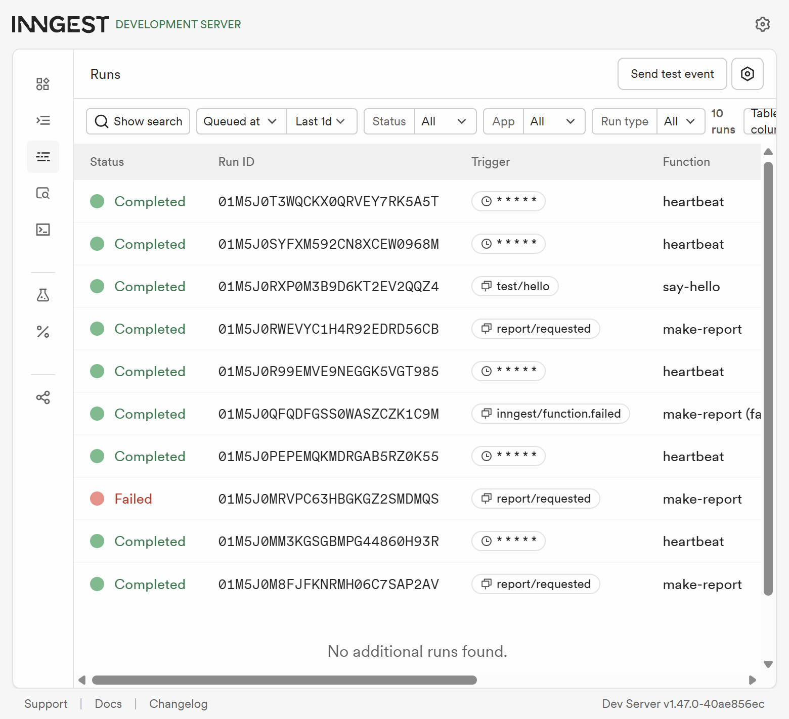

# Your First Background Job

A small Express API that accepts report requests immediately and delegates the slow work to Inngest. The Inngest Dev Server runs the background functions locally and provides a dashboard at `http://localhost:8288`.

**Developed by K M Amith Keshav**

When the API is running, visit `http://localhost:3000` to see the project home page and developer attribution.

## Requirements

- Node.js 20 or newer
- npm

Install dependencies once:

```powershell
npm install
```

## Run it

Open two terminals in this project directory.

**Terminal 1 — API:**

```powershell
npm start
```

**Terminal 2 — Inngest Dev Server:**

```powershell
npx inngest-cli@latest dev -u http://localhost:3000/api/inngest
```

Open `http://localhost:8288` to see and invoke the registered functions. The Dev Server command may prompt to download the CLI the first time.

## API and functions

| Kind | Name | Behavior |
| --- | --- | --- |
| Endpoint | `GET /health` | Returns `{ "status": "ok" }`. |
| Endpoint | `POST /reports` | Validates `topic`, sends `report/requested`, and returns `202` with a report ID. |
| Endpoint | `GET /reports/:id` | Returns the report's `pending`, `done`, or `failed` state; completed reports include the full `result.sections` content; unknown IDs return `404`. |
| Endpoint | `GET /reports` | Lists report states. |
| Inngest function | `say-hello` | Handles `test/hello`, waits five seconds, then returns a greeting. |
| Inngest function | `make-report` | Handles `report/requested`, waits eight seconds, and builds the report in a durable step. Retries twice after a failure and limits concurrent runs to two. |
| Inngest function | `heartbeat` | Runs every minute and logs the pending, done, and failed report counts. |

Reports are stored in memory for this learning project. Restarting the API clears report state; use durable storage for a production service.

## Try the report flow

PowerShell examples:

```powershell
$accepted = Invoke-RestMethod -Method Post `
  -Uri http://localhost:3000/reports `
  -ContentType 'application/json' `
  -Body '{"topic":"cats"}'
$accepted
Invoke-RestMethod -Uri "http://localhost:3000/reports/$($accepted.id)"
Start-Sleep -Seconds 10
Invoke-RestMethod -Uri "http://localhost:3000/reports/$($accepted.id)"
```

The first response is `202 Accepted` with `status: pending`. Poll again after the background sleep to see `status: done` and the generated result, including its overview, key considerations, and suggested next steps. The live demo's **Read full report** button opens that content in a readable dialog. Captured locally against the Inngest Dev Server: the POST took 69 ms.

```text
POST /reports
HTTP 202 (69 ms)
{"id":"cc88fdc6-e39e-4cdd-9b1e-9c1ab6b82c98","status":"pending"}

GET /reports/cc88fdc6-e39e-4cdd-9b1e-9c1ab6b82c98 (first poll)
{"id":"cc88fdc6-e39e-4cdd-9b1e-9c1ab6b82c98","topic":"cats","status":"pending","createdAt":"2026-10-22T14:38:19.394Z","updatedAt":"2026-10-22T14:38:19.394Z"}

GET /reports/cc88fdc6-e39e-4cdd-9b1e-9c1ab6b82c98 (after 10 seconds)
{"id":"cc88fdc6-e39e-4cdd-9b1e-9c1ab6b82c98","topic":"cats","status":"done","createdAt":"2026-10-22T14:38:19.394Z","updatedAt":"2026-10-22T14:38:27.711Z","result":{"title":"Report about cats","summary":"This report was generated for the topic \"cats\".","generatedAt":"2026-10-22T14:38:27.711Z"}}
```

Validation check: `POST /reports` with `{}` returns `400` and does not enqueue a function. `POST /reports` with `{"topic":"fail"}` produces a failed run after the initial attempt and two retries; inspect that run in the dashboard.

## Retry and cron notes

**Stage 3:** Missing or blank topics are invalid input and get a `400` immediately; retries are for failures during valid background work, not for correcting a bad request.

**Stage 4:** `0 8 * * *` runs daily at 08:00; `0 22 * * 0` runs every Sunday at 22:00 (cron schedule times are interpreted in UTC unless configured otherwise).

## Dashboard evidence

The dashboard screenshot below was captured after running successful and failed reports, invoking `say-hello`, and waiting for multiple heartbeat ticks. The failed `make-report` row can be opened in the dashboard to inspect its retry attempts.



## Tests

```powershell
npm test
```
